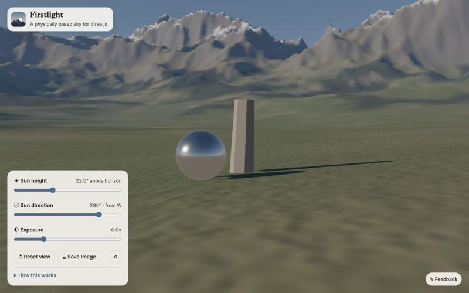
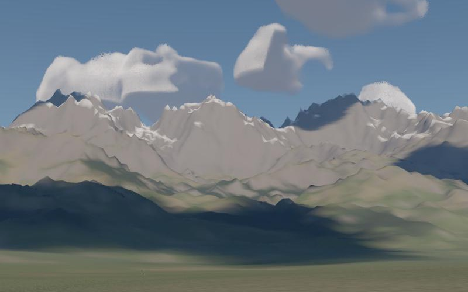
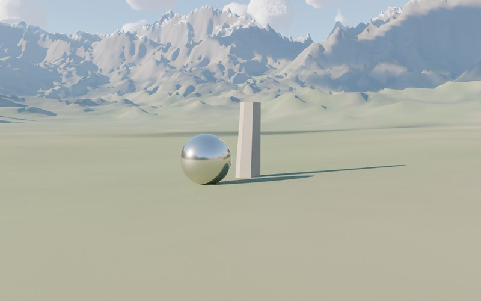
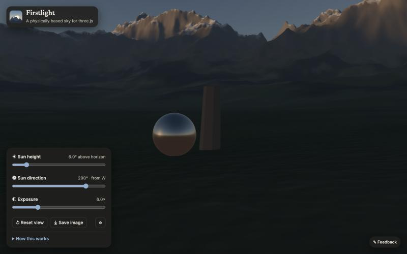

# Firstlight

Physically based sky, sun, haze and volumetric clouds for three.js, in real light units
(lux, cd/m²) with a physical camera. One atmosphere model lights the whole scene, so the sky,
the sun's colour, the clouds, the ambient light and the distance haze always agree. When the
view is still, it can settle to a path-traced frame.

**[Open the live demo →](https://amalmehta.com/Firstlight/)**









```js
import { createStage, Terrain } from 'firstlight';

const stage = createStage(document.body, { sun: { elevation: 22, azimuth: 290 } }); // sky draws now
const terrain = await Terrain.load({ seed: 7 }); // eroded valley, built in a Web Worker
const y = terrain.heightAt(0, 0);
stage.setView({ position: [-30, y + 8, 60], target: [0, y + 5, 0] }, { home: true });
stage.add(terrain, myMesh); // any three.js object; it is lit, shadowed and hazed like the rest
```

| What | Measured |
|---|---|
| GPU transmittance LUT vs CPU reference | 0.14% max error (threshold 1%) |
| Sea-level Rayleigh depth vs Bucholtz 1995 | +9% to +13% (the standard coefficients run high; labeled) |
| Sun at 60°: direct / sky light on the ground, auto EV | 99.5 klx / 9.1 klx, EV 15.4 (Sunny 16 ≈ 15) |
| GPU time per orbit frame, 1920×1200, default view (timer queries) | 15.9–17.4 ms across runs (budget 16.7 ms; marginal, check in a visible window) |
| Terrain sky occlusion: GPU bake vs CPU reference | 0.002 max difference |
| Cloud lighting vs a Monte Carlo path trace of a thick cloud slab | 35% RMS, worst 1.7× (the usual a = b = c = ½ octaves: 2.5–6× too dark) |
| Cloud pass GPU time, 1500×938, 35% cover (timer queries) | 1.3 ms default view, 3.5 ms looking up; 6.5 ms at 80% cover |
| Settled (64 path-traced samples) vs raster, mean luminance | 0.986 overall; SSIM 0.98 after a 2 px blur |
| Settle: tracer GPU time per frame, 1536×960 (timer queries) | median 24.5 ms, max 55 ms; 64 samples ≈ 105 s in a hidden pane |

**[Instructions](docs/INSTRUCTIONS.md)** · [System design](docs/SYSTEM-DESIGN.md) ·
[Concepts (CS184 → papers)](docs/CONCEPTS.md) · [Research: what next](docs/RESEARCH.md) · [Viz log](docs/VIZ-LOG.md) ·
[File structure](docs/FILE-STRUCTURE.md) · [Prompt log](docs/PROMPTS.md) · MIT license

## How it was built

How this was built and how it works, with diagrams: [docs/HOW-IT-WAS-BUILT.md](docs/HOW-IT-WAS-BUILT.md)
