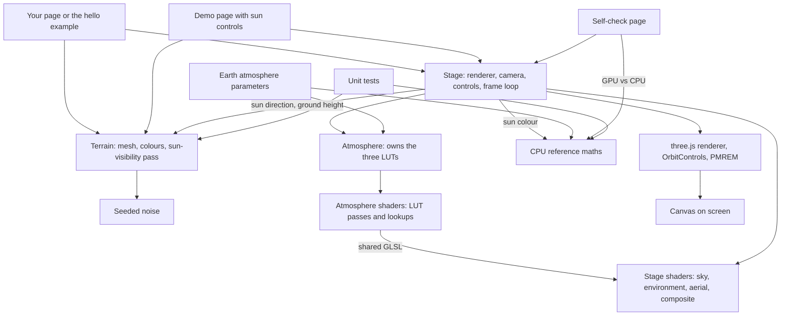
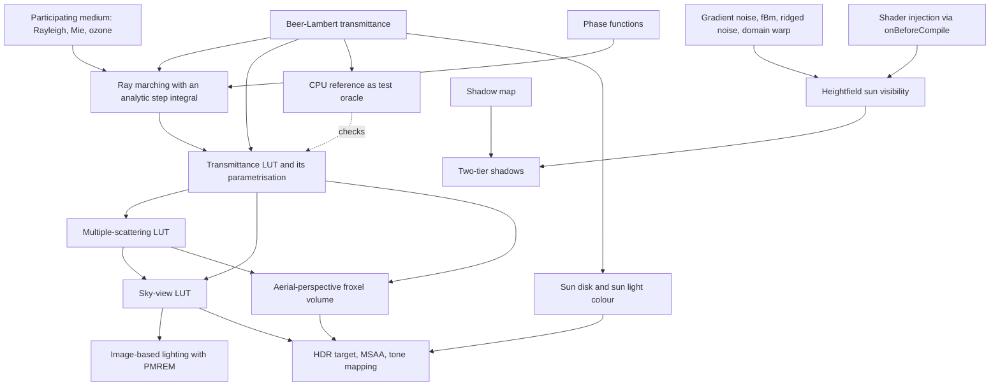

<!-- ProjectForge explainer at e33a4c6 -->
# How full 3d graphics library that can make extremely novel high fiedelity graphics by looking at the SOTA reseach was built

Firstlight is a TypeScript library on three.js. It gives an outdoor scene a physically based sky, sun, distance haze and terrain in about 30 lines. The author built it as a high-quality baseline to import into their own projects. It rests on one idea from Hillaire 2020: model the atmosphere once and bake its light transport into a few small lookup textures. Then the sky colour, the sun's colour, the ambient light and the haze all come from the same physics, at real-time cost.

## Build history

- **Idea**: the author wanted a library "for me, to use in other projects", meant to be a high-quality baseline.
- **Scope**: the author already had other graphics projects (a C++→WASM WebGL2 library, a Web Components library, a single-file three.js scene). They chose a new TypeScript library on three.js, imported as an ES module. The goal they named was "a cinematic scene in about 30 lines". The code lives in a public repo with a demo on GitHub Pages. Of the research techniques they picked (path tracing, Gaussian splatting, sky and atmosphere, sim-driven visuals), v1 could ship only one.
- **v1 research module**: sky and atmosphere. A maintained library already existed (takram's three-atmosphere, based on Bruneton 2017). The author chose to write Hillaire 2020 instead.
- **Shape**: there were four candidate first uses (robotics/RL viewer, worlds and stories, science explainer, portfolio hero). The demo scene that proves the 30-line claim became an alpine valley in the afternoon, in a calm daylight tone. CS184 (the Berkeley graphics course) shapes the docs as a concept map with citations. The library is named Firstlight, and the proposed done criteria were accepted as written.
- **2026-11-19, v1**: one commit added the whole library: the Hillaire 2020 sky, the froxel aerial perspective, the terrain with baked sun visibility, the demo, and the hello and self-check pages.
- **2026-11-19, license and deploy**: added the MIT license and the GitHub Actions workflow that type-checks, tests, builds and deploys the demo to Pages.
- **2026-11-19, CI fix**: regenerated `package-lock.json` so CI's `npm ci` matches it, and pointed the demo link at the custom domain.

## Code map

| Part | File | What it does |
|---|---|---|
| Public API | `src/index.ts` | Re-exports `createStage`, `Stage`, `Atmosphere`, `Terrain`, `Noise2D`, `EARTH` and the `reference` maths. |
| Stage | `src/stage/Stage.ts` | Creates the WebGL2 renderer, camera, orbit controls, sun light and render targets, and draws a frame on demand. |
| Stage shaders | `src/stage/shaders.ts` | GLSL for the sky background, the environment cube, the aerial-perspective volume and the final composite. |
| Atmosphere | `src/atmosphere/Atmosphere.ts` | Owns the transmittance, multi-scattering and sky-view lookup textures and rebuilds whichever is stale. |
| Atmosphere shaders | `src/atmosphere/glsl.ts` | GLSL for the medium, the phase functions, the LUT passes, the LUT lookups and `integrateScattering`. |
| Earth parameters | `src/atmosphere/params.ts` | Earth's radii and scattering and absorption coefficients in km and 1/km, with notes where the paper and its code disagree. |
| CPU reference | `src/atmosphere/reference.ts` | Plain TypeScript transmittance, sun direction and LUT mapping, used for the sun's colour and as a test oracle. |
| Terrain | `src/terrain/Terrain.ts` | Builds the 20 km valley mesh and its colours, bakes sun visibility on the GPU, and injects that shadow into lit materials. |
| Noise | `src/terrain/noise.ts` | Seeded gradient noise, fBm and ridged multifractal noise. |
| Demo | `demo/main.ts` | The live demo: sun, exposure, quality and tone sliders saved to localStorage, snapshot, benchmark. |
| Hello | `examples/hello.html` | The 27-line full scene: terrain, a steel sphere, sky, sun and orbit camera. |
| Self-check | `examples/selfcheck.ts` | Reads the GPU transmittance LUT back and compares every texel with the CPU reference, plus physical sanity checks. |
| Tests | `tests/atmosphere.test.ts`, `tests/terrain.test.ts` | Vitest checks of the reference maths against Bucholtz 1995, step-count accuracy, and terrain shape and determinism. |
| Build and deploy | `vite.config.ts`, `.github/workflows/pages.yml` | Builds the three pages and, on push to main, runs typecheck, tests and build, then deploys `dist` to Pages. |

## Concepts

**Beer-Lambert transmittance**: transmittance $T$ is the fraction of light that survives a path through a medium. Each kilometre removes a fixed fraction of the light, so the losses multiply, and the total is an exponential of a sum. The sum is the optical depth $\tau$, the integral of the extinction coefficient $\sigma_t$ (scattering plus absorption, per km) along the path. Every part of the sky needs it: how much sunlight reaches a point, and how much of a far mountain's light reaches the eye. Lives in `src/atmosphere/reference.ts` (`opticalDepth`, `transmittance`) and in `TRANSMITTANCE_FRAG` in `src/atmosphere/glsl.ts`.

$$T = e^{-\tau}, \qquad \tau = \int_0^{d} \sigma_t\big(h(s)\big)\, ds$$

**Participating medium: Rayleigh, Mie, ozone**: the air is modelled as three ingredients whose density depends only on height $h$. Rayleigh scattering by molecules is strong in blue (coefficients at 680/550/440 nm for R/G/B) and its density falls off with an 8 km scale height. Mie scattering by aerosols (haze) is grey and falls off over 1.2 km. Ozone only absorbs, with a tent-shaped profile peaking at 25 km. Without these, the sky would not be blue and sunsets would not turn red. The values come from Hillaire's reference code. Lives in `src/atmosphere/params.ts` (`EARTH`), `sampleMedium` in `src/atmosphere/glsl.ts`, and `extinctionAt` in `src/atmosphere/reference.ts`.

$$\sigma_R(h) = \beta_R\, e^{-h/8}, \quad \sigma_M(h) = \beta_M\, e^{-h/1.2}, \quad \sigma_O(h) = \beta_O \max\!\left(0,\, 1 - \tfrac{|h-25|}{15}\right)$$

**Phase functions**: a phase function gives the share of scattered light that goes off at angle $\theta$ from the incoming direction. Rayleigh scatters nearly evenly. Mie scatters strongly forward (asymmetry $g = 0.8$), which makes the bright glow around the sun. The code uses Cornette-Shanks for Mie, as Hillaire's code does. Lives in `rayleighPhase` and `miePhase` in `src/atmosphere/glsl.ts`.

$$p_R = \frac{3}{16\pi}(1+\cos^2\theta), \qquad p_M = \frac{3}{8\pi}\,\frac{(1-g^2)(1+\cos^2\theta)}{(2+g^2)\,(1+g^2-2g\cos\theta)^{3/2}}$$

**Ray marching with an analytic step integral**: to find the light scattered toward the eye along a view ray, the code walks the ray in steps. At each step it samples the medium, works out the light $S$ scattered toward the camera, and adds it, dimmed by the transmittance so far. It treats the medium as constant within a step and integrates $S\,e^{-\sigma_t t}$ exactly over the step. This stays energy-conserving even with few steps. Steps are spaced quadratically (dense near the camera, where haze is thickest). $S$ has a single-scattering part (direct sun, blocked when the planet is in the way) and a multiple-scattering part (next concept). Lives in `integrateScattering` in `src/atmosphere/glsl.ts`.

$$S = E_\odot\Big(V\,T_\odot\,(\sigma_R p_R + \sigma_M p_M) + \Psi_{ms}\,(\sigma_R + \sigma_M)\Big), \qquad L \mathrel{+}= T\,\frac{S\,(1 - e^{-\sigma_t \Delta t})}{\sigma_t}$$

**Transmittance LUT and its parametrisation**: a LUT (lookup table) here is a small texture holding precomputed values. The transmittance LUT (256×64) stores $T$ from any height $r$, looking in any direction $\mu$ (cosine from straight up), to the top of the atmosphere. The hard part is the mapping from $(r, \mu)$ to texture coordinates. Following Bruneton 2017, $v = \rho/H$, where $\rho$ is the distance to the horizon and $H$ is that distance from the top of the atmosphere. $u$ maps the distance $d$ to the atmosphere's top between its smallest and largest possible values. This puts many texels near the horizon, where $T$ changes fastest. Each texel ray-marches 128 steps, not the paper's 40. The tests record that 40 steps miss the zenith optical depth by more than 1%, because the Mie layer is only 1.2 km thick. Lives in `transmittanceUv` and `TRANSMITTANCE_FRAG` in `src/atmosphere/glsl.ts`, `transmittanceUvToRMu` in `src/atmosphere/reference.ts`, and `TRANSMITTANCE_STEPS` in the same file.

$$H = \sqrt{R_t^2 - R_b^2}, \quad \rho = \sqrt{r^2 - R_b^2}, \quad u = \frac{d - (R_t - r)}{(\rho + H) - (R_t - r)}, \quad v = \frac{\rho}{H}$$

**Multiple-scattering LUT**: light that scatters two, three or more times brightens the sky and fills in shadows near sunset. Simulating every order is expensive. Hillaire's trick (paper §5.5) assumes light that has scattered twice is spread evenly in all directions. For each height and sun angle (a 32×32 texture), the shader shoots 64 directions with 20 steps each. It gathers the second-order light $L_{2}$, including light bounced off ground with albedo 0.3. It also gathers $f_{ms}$, the share of light that would be scattered again if each event re-emitted 1. Higher orders then form a geometric series $1 + f + f^2 + \dots$, which sums in closed form. Lives in `MULTISCAT_FRAG` and `getMultiScat` in `src/atmosphere/glsl.ts`.

$$\Psi_{ms} = \frac{L_{2}}{1 - f_{ms}}$$

**Sky-view LUT**: a 192×108 texture of sky luminance for every view direction around the camera. It is rebuilt each frame because it depends on the sun and the camera height. It is built in a local frame where the sun lies in one vertical plane, so only the sun's elevation matters there. At lookup time, `skyLuminance` measures the view's azimuth relative to the sun. The rows use a square-root mapping either side of the horizon, so the horizon band gets the most texels. The columns use a square root of the angle from the sun, which makes the area near the sun dense. Each texel marches 32 steps. Drawing the sky is then one texture read per pixel. Lives in `SKYVIEW_FRAG`, `skyViewUv` and `skyLuminance` in `src/atmosphere/glsl.ts`.

**Aerial-perspective froxel volume**: aerial perspective is the haze that blue-shifts and fades far mountains. A froxel (frustum voxel) is a cell of a 3D grid laid over the camera's view. The stage renders a 32×32×32 half-float 3D texture. Each texel holds the light scattered into the view ray up to that slice's distance (RGB), plus the ray's mean transmittance (alpha). Slice $z$ sits at $s^2 \cdot 64$ km, with $s = (z + 0.5)/32$. That covers about 64 km, with most slices close by. The composite pass rebuilds each pixel's world position from depth and inverts that curve to find its slice. It applies the haze at full strength from 1 km and fades it in linearly closer than that. One simplification: the transmittance is averaged to grey, so the haze dims all three channels equally. Lives in `AERIAL_FRAG` and `COMPOSITE_FRAG` in `src/stage/shaders.ts`, and the slice loop in `Stage.render` in `src/stage/Stage.ts`.

$$L_{\text{out}} = L_{\text{surface}} \cdot \bar T + L_{\text{in}}$$

**Sun disk and sun light colour**: the visible sun disk has radiance equal to illuminance divided by its solid angle (0.2667° angular radius). It is dimmed by the transmittance toward the camera and gets a simple linear limb darkening, $1 - 0.6\,(1 - \sqrt{1 - r^2})$. The three.js `DirectionalLight` that lights objects gets its colour from the CPU reference: `sunTransmittance` at the camera's altitude with 64 steps. That is why low suns light the scene orange. Lives in `SKY_FRAG` in `src/stage/shaders.ts`, `Stage.render` in `src/stage/Stage.ts`, and `sunTransmittance` and `sunDirection` in `src/atmosphere/reference.ts`.

**CPU reference as test oracle**: an oracle is an independent implementation that the real one is checked against. `reference.ts` does the transmittance maths plainly in TypeScript. The self-check page reads the GPU LUT back and requires under 1% relative error on every value with $T \ge 0.001$. The unit tests compare sea-level Rayleigh optical depth with Bucholtz 1995 (within 15%; the tests note it runs high). They also check that the sun reddens at 2° and is near-white at 60°. Lives in `src/atmosphere/reference.ts`, `examples/selfcheck.ts`, `tests/atmosphere.test.ts`.

**Image-based lighting with PMREM**: image-based lighting lights objects with a picture of their surroundings. A mirror sphere reflects the sky, and a rough one picks up its soft colour. The stage renders the sky into a 64-pixel cube map from a sphere drawn with `ENV_FRAG`. That shader adds a simple ground term (albedo/π × sun plus sky) for directions below the horizon, so objects get light bounced up from below. The sun disk is left out because the directional light carries it. PMREM (three.js's prefiltered mipmapped radiance environment map) blurs the cube map for each roughness level, and the result becomes `scene.environment`. This is rebuilt at most every 120 ms while the sun moves, with a trailing timer so the final sun position always lands. Lives in `Stage.updateEnvironment` in `src/stage/Stage.ts` and `ENV_FRAG` in `src/stage/shaders.ts`.

**HDR target, MSAA, tone mapping**: the scene renders into a half-float colour target (HDR, high dynamic range, so the sun can be thousands of times brighter than shadow). The target uses 4× MSAA (multisample anti-aliasing) and has a float depth texture. The sky is drawn first, inside this pass, as a full-screen triangle with `renderOrder = -1000`. That way MSAA blends mountain edges against the real sky colour. The comment in `src/stage/shaders.ts` notes that drawing the sky later leaves dark fringes. The composite pass then adds aerial perspective, applies exposure (default 6, chosen by eye) and AgX or ACES tone mapping, and converts to sRGB using three.js shader chunks. Lives in the `Stage` constructor in `src/stage/Stage.ts` and `COMPOSITE_FRAG` in `src/stage/shaders.ts`.

**Gradient noise, fBm, ridged noise, domain warp**: gradient noise is smooth pseudo-random noise built from random gradients at grid points, blended with Perlin's 2002 fade curve. Here it is seeded with mulberry32, so the same seed gives the same world on every machine. fBm (fractal Brownian motion) sums octaves at double frequency and half amplitude. Ridged noise uses $(1 - |n|)^2$ for sharp crests and weights each octave by the one before, so valleys stay smooth while peaks stay rough (Musgrave). Domain warp shifts the input coordinates by another noise, so the ridges meander. `heightAt` combines these with a radial mask that raises the rim, so peaks hide the tile's edges. Lives in `src/terrain/noise.ts` and `Terrain.heightAt` in `src/terrain/Terrain.ts`.

$$h = \text{floor} + \text{relief}\cdot m\,(0.25 + 0.75\,\text{ridged})\,(0.75 + 0.5\,m)$$

**Shader injection via onBeforeCompile**: three.js builds its standard material shaders from named chunks such as `#include <lights_fragment_begin>`. `onBeforeCompile` lets code edit that text before compiling. The terrain uses it to add sub-cell detail: albedo variation at 2–60 m and a bump normal from screen-space derivatives. Both fade with distance before they would shimmer. It also uses it to multiply the directional light's colour by a sun-visibility value. Existing hooks are kept, and the program cache key is extended so three.js does not reuse the wrong shader. Lives in `Terrain` constructor, `shadeWithSun` and `injectSunVisibility` in `src/terrain/Terrain.ts`.

**Heightfield sun visibility**: when the sun moves, one GPU pass marches from every grid vertex (513×513) toward the sun over a float height texture. It keeps the softest occlusion it meets, following Quilez's soft-shadow rule: visibility is clearance over distance, scaled by 14. Steps grow with distance, up to 64 of them. Materials then need one texture read per pixel. Lives in `SUN_VIS_PASS`, `SUN_VIS_LOOKUP` and `setSunDirection` in `src/terrain/Terrain.ts`.

$$\text{vis} = \min_i\ \operatorname{clamp}\!\left(\frac{14\,\Delta h_i}{t_i},\,0,\,1\right)$$

**Two-tier shadows**: a shadow map renders depth from the sun and covers only a box around the camera target. Here that box is ±400 m at 4096², which leaves a hard edge on a 20 km valley at low sun. So mountains shadow the land, and anything on it, through the baked heightfield visibility. Small objects cast their own shadows through the shadow map. The shadow map redraws only when the sun or orbit target changes, or when the scene is animating or was edited. Lives in the `Stage` constructor and `Stage.render` (`shadowKey`) in `src/stage/Stage.ts`, and `Terrain` in `src/terrain/Terrain.ts`.

## One input, start to finish

The input is `examples/hello.html`: seed 7, sun at 22° elevation and 290° azimuth, a steel sphere.

1. **Build the terrain.** `new Terrain({ seed: 7 })` in `src/terrain/Terrain.ts` creates `Noise2D(7)` (`src/terrain/noise.ts`), which shuffles a permutation table and gradients with mulberry32. It makes a 20 000 m `PlaneGeometry` with 512 segments and sets each vertex's height with `heightAt`. It colours each vertex by height and slope (grass, dry grass, conifer belt, rock, snow above 1300 m). It then packs the heights into a 513×513 float `DataTexture` and creates the sun-visibility render target and its pass.
2. **Place the sphere.** The page calls `terrain.heightAt(0, 0)` to find the valley floor and sets the camera and sphere relative to it.
3. **Create the stage.** `createStage` → `Stage` constructor in `src/stage/Stage.ts`. It asks for WebGL2 and `EXT_color_buffer_float`. If either is missing, `unsupported` puts a readable message in the container and throws `FirstlightUnsupportedError`. Otherwise it sets up the `WebGLRenderer` (AgX, exposure 6, sRGB, PCF shadows with manual updates), the camera and `new Atmosphere()`. `Atmosphere` copies `EARTH` into its uniforms and compiles the three LUT materials. The stage also creates the sky triangle, the environment sphere, the 32³ aerial volume, the composite quad, the sun light with its 4096² shadow map, and `OrbitControls`. Damping is off under Reduce Motion. Double-click or R resets the camera.
4. **Set the sun.** `Stage.setSun` calls `sunDirection(22, 290)` in `src/atmosphere/reference.ts`. That gives a unit vector pointing up 22° and toward west-north-west (−x, −z), written into `uSunDir`. It marks the environment dirty and calls `invalidate`, which schedules a single `requestAnimationFrame`.
5. **Add objects.** `Stage.add(terrain, sphere)` finds the terrain's `shadeWithSun`, `heightAt` and `setSunDirection` by duck typing. It then walks the scene and runs `shadeWithSun` on the sphere's `MeshStandardMaterial`, so the sphere's sunlight will also be scaled by terrain visibility.
6. **Frame starts.** `Stage.tick` → `Stage.render`. It keeps the camera at least 1.5 m above `heightAt`. It builds the inverse view-projection matrix and converts the camera to atmosphere space: kilometres, with the planet centre at the origin (`camAtm.y = 6360 + y/1000`).
7. **Atmosphere LUTs.** `Atmosphere.update` in `src/atmosphere/Atmosphere.ts` runs the transmittance pass and the multi-scattering pass, on this first frame only (`staticDirty`). It then runs the sky-view pass for the camera's radius. Each pass is a full-screen draw of a shader from `src/atmosphere/glsl.ts`.
8. **Sun light.** `sunTransmittance(EARTH, 22, altitude, 64)` on the CPU gives the RGB fraction of sunlight reaching the camera, which becomes `sun.color`. The light is placed 4000 m from the orbit target along the sun direction.
9. **Terrain shadow.** `Terrain.setSunDirection` sees a new direction and runs `SUN_VIS_PASS` once into its 513×513 visibility texture. The stage's shadow key has changed, so the shadow map is flagged for redraw.
10. **Environment.** `Stage.updateEnvironment` renders the sky sphere (`ENV_FRAG`) into the 64-pixel cube map. PMREM prefilters it and sets it as `scene.environment`.
11. **Aerial volume.** The stage draws `AERIAL_FRAG` 32 times, once per slice of the 3D target. Each slice calls `integrateScattering` from the camera out to its distance, with 4 to 24 steps.
12. **Main pass.** The scene renders into the 4× MSAA half-float target. First comes the sky triangle (`SKY_FRAG`: a sky-view LUT read plus the limb-darkened sun disk). Then the terrain: vertex colour × detail noise, bump normal, directional light × `sunVisibility`, the object shadow map, and environment light. Then the steel sphere, which mirrors the environment cube and is shadowed by the mountains if they block the sun.
13. **Composite.** `COMPOSITE_FRAG` reads colour and depth, rebuilds each pixel's distance in km, picks the aerial slice and applies `col · T̄ + L_in`. Then it tone-maps and converts to sRGB onto the canvas.
14. **Idle.** No `loop` is set and damping has settled, so no further frame is requested. The next frame happens only when the controls fire `change`, the sun moves, or the page resizes.

## Where this came from

Written from the spec, the author's decisions, the git history (3 commits, all 2026-11-19) and the code as of commit e33a4c6.
