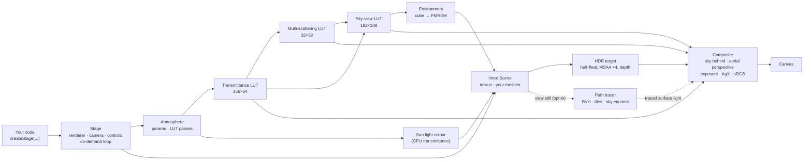

# System design

Firstlight is a small TypeScript layer on three.js. It gives any web project a
physically lit outdoor scene in a few lines. v1 is the core (stage, camera,
output) plus one research module: the sky and atmosphere model from Hillaire
(2020).

## The one idea

**The sky is the light source, not a backdrop.** One atmosphere model produces
four things that usually come from four unrelated hacks:

| What you see | Usual three.js approach | Firstlight |
|---|---|---|
| Sky pixels | HDRI skybox or Preetham `Sky.js` | Sky-view LUT (Hillaire §5.2) |
| Sun colour | A hand-picked `DirectionalLight` colour | Transmittance from the sun to the ground (same LUT) |
| Ambient / reflections | An unrelated HDRI | The same sky rendered into a cube map, then prefiltered with PMREM |
| Distance haze | `scene.fog` (exponential, grey) | Aerial perspective: a 32³ froxel volume of in-scattering and transmittance (Hillaire §5.4) |

Because all four come from one model, moving the sun keeps them in agreement:
the light goes orange, the shadows go blue, the haze goes warm. That agreement
is what reads as "cinematic". The obvious version (HDRI + fog + hand-tuned
lights) looks pasted together the moment you change the time of day.

## Architecture

## Components

| Module | Job | CS184 lecture it rests on |
|---|---|---|
| `atmosphere/params.ts` | Earth constants (Hillaire 2020 / Bruneton 2017), density profiles | Radiometry |
| `atmosphere/reference.ts` | CPU reference: optical depth, transmittance, sun colour. Used for the light colour and as the test oracle | Radiometry, Monte Carlo integration |
| `atmosphere/shaders.ts` | GLSL for the three LUT passes, sky and aerial perspective | Monte Carlo integration, global illumination |
| `atmosphere/Atmosphere.ts` | Owns the LUT render targets and recomputes them when the sun or params change | — |
| `stage/Stage.ts` | Renderer, HDR target, camera, OrbitControls with reset, resize, render-on-demand, snapshot, Reduce Motion | Transforms, perspective projection, hidden surface removal |
| `stage/shaders.ts` | Sky background, environment cube, aerial froxel volume, composite (exposure, AgX, sRGB) | Color and perception |
| `terrain/Terrain.ts` | Seeded ridged-fBm heightfield; albedo by slope and height (grass, conifer, rock, snow); per-pixel detail; baked sun visibility applied to every lit material | Meshes, texture mapping, shading, ray tracing |
| Environment (in `Stage`) | Renders the sky into a 64² cube map → PMREM → `scene.environment` | Materials (image-based lighting) |
| `clouds/Clouds.ts` + `glsl.ts` | Cumulus layer: GPU-generated noise, reduced-resolution march, shadow map; shades lit materials and the haze | Monte Carlo integration, volume rendering |
| `pathtrace/PathTrace.ts` | Settle mode: wraps three-gpu-pathtracer (loaded on first use), patches its shader for premultiplied misses, cloud shadows and terrain detail, and tiles samples to a frame-time target | Path tracing, Monte Carlo integration, BVH |
| `clouds/reference.ts` + `pathTrace.ts` | CPU mirror of the cloud maths and a Monte Carlo slab path tracer the octaves are fitted to | Monte Carlo integration, path tracing |

## Main flows

1. **Startup.** `createStage` checks WebGL2 and `EXT_color_buffer_float`. If
   either is missing, it writes a plain message into the container and stops.
   Otherwise it builds the HDR target and the atmosphere LUTs once, and renders.
2. **Sun change.** `stage.setSun({ elevation, azimuth })` recomputes the sky-view
   LUT (cheap) and the sun colour (CPU), and marks the environment dirty. The
   transmittance and multi-scattering LUTs depend only on the atmosphere, so
   they are not recomputed. The environment cube is rebuilt at most every
   120 ms while the sun is being dragged, and again once it stops.
3. **Frame.** Only when dirty (camera moved, sun moved, resize, or the user
   called `invalidate()`): update the sky-view LUT, rebake terrain sun visibility
   if the sun moved, render the 32 aerial slices, render the scene into the HDR
   target (sky first), march the clouds into a reduced-resolution buffer (stopping at scene
   depth), then composite to the canvas (haze, then clouds upsampled by depth). The cloud
   shadow map is rebaked only when the sun, the clouds or the orbit target move. The sun's shadow map is
   redrawn only when the sun or orbit target moves, or in `loop()` mode.
   `stage.loop(fn)` opts into continuous animation.
4. **Settle (opt-in `pathTrace`).** Every frame compares the camera pose, projection and buffer
   size with the last one, and `invalidate()` marks a change. A change draws the raster frame
   and starts a 400 ms timer. When it fires with nothing changed, the stage loads the tracer
   (once), builds the BVH (worker) and renders the sky into a 256×128 float equirect map that
   becomes the tracer's environment. Then each frame adds one tile of a sample, and the
   composite blends the traced surface light over the last raster frame. The sky, aerial
   volume and cloud buffer are not redrawn (nothing moved), so a settling frame is only the
   tile plus the composite. It stops at `samples`; then the GPU idles.

## Where data lives

Nowhere persistent. The library holds GPU textures in memory. The demo page
keeps its sun and exposure settings in `localStorage`, wrapped in try/catch;
losing them is harmless.

## Key decisions and trade-offs

- **three.js, not our own engine.** Reuses a mature renderer: PBR, shadows,
  loaders, PMREM. Trade-off: three's update cadence. Pinned to `three@0.187`.
- **WebGL2, not WebGPU (yet).** The path tracer and splat libraries that later
  modules would use are WebGL2-only today. Revisit when they port.
- **Hillaire written here, not takram (Bruneton).** We own every line, it reads
  as a teaching reference, and it extends to clouds later. Trade-off: about
  600 lines of shader to verify. That is why there is a CPU reference and a
  self-check page.
- **Aerial perspective from the paper's froxel volume.** v1 first ray-marched
  per pixel (16 samples); profiling showed that pass alone took about 8.5 ms at
  1536×1152. The 32×32×32 volume (2 km per slice on a square-root curve, 64 km
  reach) costs about 2 ms and looks the same by eye. Trade-off: transmittance
  is stored as a grey average (alpha), as in the paper.
- **No freeze while shaders compile.** Two causes, measured separately on Chrome/macOS:
  (1) GLSL compile+link, which `KHR_parallel_shader_compile` moves off the main thread
  (`renderer.compileAsync`; raw WebGL: 0.5 ms on the main thread, 600 ms off it); and
  (2) the *first draw* of each pipeline, which still stalls 30–230 ms while the GPU process
  builds it, and can't be made async. So the stage compiles every internal pass material in
  parallel before frames start (`stage.ready`), then runs its first frame in steps, one task
  per step (`renderSteps(limit)`), yielding via `scheduler.yield`/`MessageChannel` (not
  `setTimeout`, which hidden tabs throttle). `stage.add()` compiles new objects (and a
  terrain's bakes, via `prepare()`) against the real scene's lights and environment, inserts
  them hidden, then shows them one per task. Longest main-thread task at load went from
  412–465 ms (two freezes) to 126–234 ms across runs (many short tasks).
- **Erosion filter and off-thread terrain.** Heights are built on a 513² grid, then carved by
  an independent implementation of the stripe-based erosion filter Johansen describes (2026,
  after Clay John): 3 octaves of jittered-cell cosine gullies aligned across the local slope,
  faded to an altitude target on flat ground, masked down the octaves. No code was copied
  (its licence couldn't be confirmed). Defaults (900 m spacing, 40 m depth) were picked by
  side-by-side comparison. Building the terrain costs ~2.7 s of CPU, so `Terrain.load()` runs
  the pure `buildTerrainData()` in a Web Worker and transfers the typed arrays back; the sky
  draws immediately. `heightAt` now samples the final grid bilinearly, so it matches the mesh.
  Longest main-thread task at load fell from ~4 s to ~0.47 s (shader compilation remains).
- **Terrain sky occlusion (sky-view factor).** Baked once per terrain (8.2 ms GPU, 513²): per
  vertex, the horizon in 16 azimuths out to 8 km, then cosine-weighted sky irradiance above it
  divided by the same with the horizon at 0° (Dozier & Frew's irradiance definition, made
  relative because the environment map already holds the ground below the horizontal). Applied
  to indirect light of every lit material, with 35% of blocked skylight put back as terrain bounce
  (an estimate). CPU reference `terrain/skyView.ts` is unit-tested against closed forms; the
  GPU bake matches it to 0.002 on the same height grid (self-check). Effect in the demo valley is
  small (−1% mean brightness): the valley is wide open; gully walls are where it bites.
- **Ambient occlusion on indirect light only.** three's GTAOPass (Jimenez 2016) computes AO
  in "Off" output mode from its own half-res normal/depth G-buffer; every lit material is
  patched to scale only indirect diffuse and indirect specular (via three's
  computeSpecularOcclusion). The default multiply-the-image mode would also darken sunlit
  creases. Settings (radius 10 m, resolution 0.35, 12 GTAO and 16 denoise samples) were
  chosen by GPU timer queries: +0.6 ms at the default view, 1920×1200; 8 samples left
  visible grain. Off switch: `ambientOcclusion: false`.
- **Shadowed haze.** When a Terrain is added, the aerial-volume pass gets the heightfield
  and marches toward the sun from each scattering sample (`TERRAIN_SHADOW` in
  `atmosphere/glsl.ts`). Air in a ridge's shadow stops scattering direct sunlight. Measured:
  +0.8 ms per frame; at a 5° sun a shaded ridge pixel goes from 111 to 85 (red channel);
  at noon the image is pixel-identical. Off switch: `shadowedHaze: false`.
- **Terrain shadows from the heightfield, not the shadow map.** A shadow map
  covers a box around the target; at low sun its edge cut a hard line across the
  valley floor. Marching the heightfield towards the sun gives soft mountain
  shadows everywhere. It's baked into a 513² texture only when the sun moves
  (a per-pixel march cost about 6 ms per frame). The same lookup is injected
  into every lit material the stage holds, so objects fall into mountain shadow
  with the ground. Objects still cast their own small shadows via the shadow map.
- **Photometric units and a physical camera.** The LUTs are transfer functions; the sun's
  illuminance (133 800 lux above the atmosphere, Darula et al. 2005 as cited by Kittler &
  Darula) turns them into cd/m². Exposure follows Lagarde & de Rousiers 2014
  (L_sat = 1.2·2^EV100). Auto mode is an incident light meter at the camera (C = 250,
  ISO 2720): direct sun on a horizontal sensor (CPU transmittance) plus sky irradiance
  (a 128-sample GPU integral of the sky-view LUT, read back asynchronously). All light is
  pre-exposed before it reaches half-float targets; the sun disk is clamped at 6·10⁴.
  A display gain of 1.5 puts a metered 18% card at AgX's mid-grey; that constant is a
  display calibration, not physics. The environment map is rescaled by
  `environmentIntensity` so its throttled rebuild never lags the exposure.
  Measured: at a 60° sun, direct 99.5 klx (Frostbite's reference ≈100 klx), sky 9.1 klx
  (low end against Frostbite's generic ≈20 klx), EV 15.4 (Sunny 16 ≈ 15).
- **Render on demand.** Static scenes cost nothing when idle. This is the
  battery story behind the portfolio-hero use.
- **AgX tone mapping** (three built-in) over ACES: AgX desaturates bright
  highlights towards white instead of skewing hues, so the sun and the horizon
  stay natural.

- **Settle: the tracer replaces surface light only.** The composite still draws the sky,
  aerial perspective, clouds, exposure and tone mapping from the raster depth, so a settled
  frame differs from the raster one only where the raster approximations (shadow map, GTAO,
  sky-view factor, prefiltered environment, screen-space detail) differ from traced light, and
  the fade between them doesn't jump in sky or haze. Trade-off: haze and clouds are not traced
  (no light scattered into shadows by the haze, no reflections of clouds).
- **Settle: patch the tracer's shader rather than fork it.** Three string patches, each
  anchored on one line of three-gpu-pathtracer 0.0.28 (pinned) and each tested against the
  installed shader: primary misses add nothing (premultiplied alpha over the raster sky; a
  black background map would have cost a 17th texture unit), the sun is dimmed by the cloud
  shadow map, and terrain hits get the terrain's procedural detail (marked by vertex alpha).
  Trade-off: an upgrade can move the anchors; the tests then fail instead of the image changing.
- **Settle: WebGL path of a library that now leads with WebGPU.** 0.0.28's README says it
  requires WebGPU; the WebGL class still ships but is deprecated (its warning is filtered).
  Chosen because the stage is WebGL2. Trade-off: a later release may drop it; pinned.
- **Settle: small tiles, as many per frame as fit.** A whole sample is about a second of GPU
  here and its cost is uneven (6×6 tiles: median 26 ms, but the tiles where rays graze the far
  terrain took 240–480 ms). So tiles are small (~12k pixels, 12×12 at 1536×960) and each frame
  draws as many as keep it near 30 ms, backing off at once after a slow frame. Timer queries:
  the tracer's GPU time per frame was median 24.5 ms, max 55 ms, which bounds how long a drag
  can wait behind it.
- **Clouds: published recipe, refitted constants.** The density model, phase function and
  integration follow Schneider 2015, Jendersie & d'Eon 2023 and Hillaire 2016. The
  multiple-scattering octaves do not: the quoted a = b = c = ½ was 2.5–6× too dark against
  our own path tracer, so N 8, a 0.8, b 0.9, c 0.25 were fitted (35% RMS). Trade-off: a fit
  to one slab, not to every cloud shape.
- **Clouds at reduced resolution, no temporal accumulation.** Render-on-demand means a still
  frame must be complete on its own, so the buffer is ~0.2 MP (scale 2-5 by canvas size),
  jittered per step, and upsampled using depth. Trade-off: softer, slightly grainy edges.
- **Loop bounds the compiler cannot see.** Cloud shaders multiply loop bounds by a uniform
  that is always 1, which stops unrolling: compile 1.4 s → 0.11 s for the march, at no
  measurable GPU cost at the default view.

## Scale and what would change

v1 targets one canvas per page, one sun, one terrain tile of about 20 km.
- Several canvases per page: share the LUTs between stages (they depend only on
  the atmosphere params).
- Bigger worlds (more than 50 km): terrain LOD (CDLOD or clipmaps) and reversed-Z
  depth. Today, near = 1 m and far = 60 km on a 32-bit float depth buffer.
- Weaker GPUs (phones): fewer aerial slices, a lower DPR cap, fewer terrain segments.

## Next ten steps (designed for, not built)

1. ~~Volumetric clouds~~ built (see Components). Next for clouds: temporal accumulation
   while the camera is still, clouds in the environment map, wind via `offset` in `loop()`.
2. ~~A progressive path-traced still mode~~ built (settle, see Components). Next: a denoiser
   (OIDN is WebGPU-only in the library), tracing the haze, and using the converged frame as
   ground truth to tune GTAO and the sky-view factor (see VIZ-LOG.md).
3. Gaussian splats (Spark). They are added to `stage.scene` like any mesh;
   aerial perspective applies through depth, if splats write depth.
4. Sim visuals: GPU particles that shade with `stage.sunColor` / `scene.environment`.
5. WebGPU/TSL port of the atmosphere shaders.
6. Height-aware object shadowing (today an object uses the visibility at ground level under it).
7. Night: moon, stars, and Purkinje shift (CS184 Color & Perception).
8. An npm package with typed exports.
9. A Mac wrapper (WKWebView) for native apps.
10. A shared LUT cache across stages.

The things that would force a rework are kept stable now: the LUT textures are
exposed through `atmosphere.textures`, the stage has a single render loop with
hooks, and the composite reads only the HDR colour and depth.

## Testing

- **CPU (Vitest):** atmosphere reference against Bucholtz (1995) optical
  depths; sunset reddening; zenith clear-sky values; sun-direction maths;
  terrain determinism.
- **GPU (self-check page):** reads back the transmittance LUT and compares it
  with the CPU reference (max relative error must be under 1%); checks the cloud buffer is
  finite and in range and the cloud shadow map both shades and lets sun through.
- **Clouds (Vitest):** phase normalisation, the analytic slab for the integration step,
  octave energy, and the octave fit against a seeded Monte Carlo path tracer.
- **Path tracing (Vitest):** each shader patch applies to the installed three-gpu-pathtracer
  shader and fails if its anchor moves; the tiling rule; the RGBA colour workaround.
- **Browser:** the demo is opened in the app's browser to check console errors,
  GPU-synced frame cost while orbiting (≈13.7 ms net at 1920×1200), and light,
  dark and phone-width screenshots. `stage.benchmark()` measures real frame
  intervals but needs a visible tab.

## Threat model

A static library and a static page: no accounts, no server, no user data, no
network calls at runtime except Google Fonts on the demo page (three is bundled
by Vite). The demo stores its sun, exposure and settings in localStorage, says so
in Settings, and has a "Clear saved settings" button. Risks are supply-chain
only: three, plus three-gpu-pathtracer and three-mesh-bvh for settle mode, all pinned to exact
versions (the tracer is downloaded only when settle mode is used). The feedback link opens GitHub
in a new tab with `rel="noopener"`. No user input reaches a shader except
numeric sliders, clamped to their ranges.

## Known limits

- Single scattering is ray-marched; higher orders use Hillaire's isotropic
  multi-scattering approximation, which is accurate for Earth-like
  atmospheres, less so for very dense ones (see paper §7).
- The camera must stay inside the atmosphere (no views from space in v1).
- Terrain sun visibility is at grid resolution (39 m) and read at ground level,
  so a tall object's top is shadowed like its base.
- Aerial transmittance is grey (one channel), as in the paper.
- Terrain is a single 20 km tile with no LOD.
- Clouds: reflections, the environment light and the sky part of the meter ignore them;
  edges are soft and a little grainy at reduced resolution; light scattered through a cloud
  onto the ground is not added; the octave lighting is within ~35% of a path tracer, not exact.
  One layer only (cumulus); no cirrus or fog banks.
- Settle (path tracing): haze and clouds are composited, not traced; the sun is a delta light
  (hard shadow edges, no penumbra); materials are read as plain MeshStandard/Physical
  properties, so other custom shader edits are invisible to the tracer (terrain detail is
  ported by hand); the first settle costs two main-thread tasks (~0.36 s tracer setup once,
  ~0.6 s geometry merge per scene change) and a BVH build in a worker (~5 s for the valley,
  single-threaded without cross-origin isolation); 64 samples took about 100 s from stillness
  in the hidden test pane at 1536×960 (visible-window timing is a checklist item); no denoiser. The stage does not rebuild its LUTs after a WebGL context
  loss (seen once in testing when a harness queued hundreds of tiles).
- Erosion is aesthetic, not hydrology: drainage lines can stop part-way down a slope, and
  at the 39 m grid some foothills form small pyramids rather than ridges.
- Each heavy pipeline's first draw is still one 100–230 ms task (Chrome/macOS builds it in
  the GPU process on first use); several tasks at load exceed the 50 ms long-task line.
  Smaller shaders or fewer variants would be the next lever.
- In a hidden tab, three's `compileAsync` polls on throttled timers, so a page opened in
  the background finishes loading slowly (it completes once visible).
- Terrain sky occlusion works at grid resolution (39 m) and doesn't see sub-grid relief; the
  terrain-bounce share (35%) is a constant, not a solve.
- GPU-timer frame costs vary about ±1.5 ms between runs in the app's hidden browser pane
  (default view measured 15.9 ms one session, 17.4 ms another). Same-run A/B deltas are
  reliable; the absolute 60 fps claim at 1920×1200 is marginal and needs a visible-window
  check (Settings → Measure).
- A close-up view filling the frame with the mirror sphere costs ≈18.6 ms GPU at
  1920×1200 even without AO; Balanced quality is tuned for the default view.
- Shadowed haze shades only single scattering; the multiple-scattering term (sky-like
  light) still reaches shaded air. Sky pixels (the background) don't see terrain shadows,
  only terrain pixels do. Shafts are as sharp as the 32×32 froxel grid allows.
- The auto meter assumes the camera stands in sunlight (it adds direct sun even when the
  camera is in a ridge's shadow), like metering the sunlit side of a scene.
- Sun-drag frames cost ≈17 ms net (GPU-synced upper bound, 1920×1200): the sky-view LUT,
  sun-visibility bake, meter pass and throttled environment rebuild land together.
