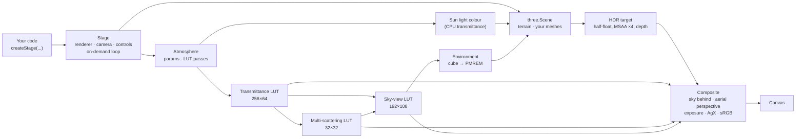

# System design

Firstlight is a small TypeScript layer on three.js. It gives any web project a
physically lit outdoor scene in a few lines. v1 is the core (stage, camera,
output) plus one research module: the sky and atmosphere model from Hillaire
(2020).

## The one idea

**The sky is the light source, not a backdrop.** One atmosphere model produces
four things that usually come from four unrelated hacks:

| What you see | Usual three.js approach | Firstlight |
|---|---|---|
| Sky pixels | HDRI skybox or Preetham `Sky.js` | Sky-view LUT (Hillaire §5.2) |
| Sun colour | A hand-picked `DirectionalLight` colour | Transmittance from the sun to the ground (same LUT) |
| Ambient / reflections | An unrelated HDRI | The same sky rendered into a cube map, then prefiltered with PMREM |
| Distance haze | `scene.fog` (exponential, grey) | Aerial perspective: a 32³ froxel volume of in-scattering and transmittance (Hillaire §5.4) |

Because all four come from one model, moving the sun keeps them in agreement:
the light goes orange, the shadows go blue, the haze goes warm. That agreement
is what reads as "cinematic". The obvious version (HDRI + fog + hand-tuned
lights) looks pasted together the moment you change the time of day.

## Architecture

## Components

| Module | Job | CS184 lecture it rests on |
|---|---|---|
| `atmosphere/params.ts` | Earth constants (Hillaire 2020 / Bruneton 2017), density profiles | Radiometry |
| `atmosphere/reference.ts` | CPU reference: optical depth, transmittance, sun colour. Used for the light colour and as the test oracle | Radiometry, Monte Carlo integration |
| `atmosphere/shaders.ts` | GLSL for the three LUT passes, sky and aerial perspective | Monte Carlo integration, global illumination |
| `atmosphere/Atmosphere.ts` | Owns the LUT render targets and recomputes them when the sun or params change | — |
| `stage/Stage.ts` | Renderer, HDR target, camera, OrbitControls with reset, resize, render-on-demand, snapshot, Reduce Motion | Transforms, perspective projection, hidden surface removal |
| `stage/shaders.ts` | Sky background, environment cube, aerial froxel volume, composite (exposure, AgX, sRGB) | Color and perception |
| `terrain/Terrain.ts` | Seeded ridged-fBm heightfield; albedo by slope and height (grass, conifer, rock, snow); per-pixel detail; baked sun visibility applied to every lit material | Meshes, texture mapping, shading, ray tracing |
| Environment (in `Stage`) | Renders the sky into a 64² cube map → PMREM → `scene.environment` | Materials (image-based lighting) |

## Main flows

1. **Startup.** `createStage` checks WebGL2 and `EXT_color_buffer_float`. If
   either is missing, it writes a plain message into the container and stops.
   Otherwise it builds the HDR target and the atmosphere LUTs once, and renders.
2. **Sun change.** `stage.setSun({ elevation, azimuth })` recomputes the sky-view
   LUT (cheap) and the sun colour (CPU), and marks the environment dirty. The
   transmittance and multi-scattering LUTs depend only on the atmosphere, so
   they are not recomputed. The environment cube is rebuilt at most every
   120 ms while the sun is being dragged, and again once it stops.
3. **Frame.** Only when dirty (camera moved, sun moved, resize, or the user
   called `invalidate()`): update the sky-view LUT, rebake terrain sun visibility
   if the sun moved, render the 32 aerial slices, render the scene into the HDR
   target (sky first), then composite to the canvas. The sun's shadow map is
   redrawn only when the sun or orbit target moves, or in `loop()` mode.
   `stage.loop(fn)` opts into continuous animation.

## Where data lives

Nowhere persistent. The library holds GPU textures in memory. The demo page
keeps its sun and exposure settings in `localStorage`, wrapped in try/catch;
losing them is harmless.

## Key decisions and trade-offs

- **three.js, not our own engine.** Reuses a mature renderer: PBR, shadows,
  loaders, PMREM. Trade-off: three's update cadence. Pinned to `three@0.187`.
- **WebGL2, not WebGPU (yet).** The path tracer and splat libraries that later
  modules would use are WebGL2-only today. Revisit when they port.
- **Hillaire written here, not takram (Bruneton).** We own every line, it reads
  as a teaching reference, and it extends to clouds later. Trade-off: about
  600 lines of shader to verify. That is why there is a CPU reference and a
  self-check page.
- **Aerial perspective from the paper's froxel volume.** v1 first ray-marched
  per pixel (16 samples); profiling showed that pass alone took about 8.5 ms at
  1536×1152. The 32×32×32 volume (2 km per slice on a square-root curve, 64 km
  reach) costs about 2 ms and looks the same by eye. Trade-off: transmittance
  is stored as a grey average (alpha), as in the paper.
- **Ambient occlusion on indirect light only.** three's GTAOPass (Jimenez 2016) computes AO
  in "Off" output mode from its own half-res normal/depth G-buffer; every lit material is
  patched to scale only indirect diffuse and indirect specular (via three's
  computeSpecularOcclusion). The default multiply-the-image mode would also darken sunlit
  creases. Settings (radius 10 m, resolution 0.35, 12 GTAO and 16 denoise samples) were
  chosen by GPU timer queries: +0.6 ms at the default view, 1920×1200; 8 samples left
  visible grain. Off switch: `ambientOcclusion: false`.
- **Shadowed haze.** When a Terrain is added, the aerial-volume pass gets the heightfield
  and marches toward the sun from each scattering sample (`TERRAIN_SHADOW` in
  `atmosphere/glsl.ts`). Air in a ridge's shadow stops scattering direct sunlight. Measured:
  +0.8 ms per frame; at a 5° sun a shaded ridge pixel goes from 111 to 85 (red channel);
  at noon the image is pixel-identical. Off switch: `shadowedHaze: false`.
- **Terrain shadows from the heightfield, not the shadow map.** A shadow map
  covers a box around the target; at low sun its edge cut a hard line across the
  valley floor. Marching the heightfield towards the sun gives soft mountain
  shadows everywhere. It's baked into a 513² texture only when the sun moves
  (a per-pixel march cost about 6 ms per frame). The same lookup is injected
  into every lit material the stage holds, so objects fall into mountain shadow
  with the ground. Objects still cast their own small shadows via the shadow map.
- **Photometric units and a physical camera.** The LUTs are transfer functions; the sun's
  illuminance (133 800 lux above the atmosphere, Darula et al. 2005 as cited by Kittler &
  Darula) turns them into cd/m². Exposure follows Lagarde & de Rousiers 2014
  (L_sat = 1.2·2^EV100). Auto mode is an incident light meter at the camera (C = 250,
  ISO 2720): direct sun on a horizontal sensor (CPU transmittance) plus sky irradiance
  (a 128-sample GPU integral of the sky-view LUT, read back asynchronously). All light is
  pre-exposed before it reaches half-float targets; the sun disk is clamped at 6·10⁴.
  A display gain of 1.5 puts a metered 18% card at AgX's mid-grey; that constant is a
  display calibration, not physics. The environment map is rescaled by
  `environmentIntensity` so its throttled rebuild never lags the exposure.
  Measured: at a 60° sun, direct 99.5 klx (Frostbite's reference ≈100 klx), sky 9.1 klx
  (low end against Frostbite's generic ≈20 klx), EV 15.4 (Sunny 16 ≈ 15).
- **Render on demand.** Static scenes cost nothing when idle. This is the
  battery story behind the portfolio-hero use.
- **AgX tone mapping** (three built-in) over ACES: AgX desaturates bright
  highlights towards white instead of skewing hues, so the sun and the horizon
  stay natural.

## Scale and what would change

v1 targets one canvas per page, one sun, one terrain tile of about 20 km.
- Several canvases per page: share the LUTs between stages (they depend only on
  the atmosphere params).
- Bigger worlds (more than 50 km): terrain LOD (CDLOD or clipmaps) and reversed-Z
  depth. Today, near = 1 m and far = 60 km on a 32-bit float depth buffer.
- Weaker GPUs (phones): fewer aerial slices, a lower DPR cap, fewer terrain segments.

## Next ten steps (designed for, not built)

1. Volumetric clouds (Hillaire 2016, Schneider 2015). They read the same
   transmittance and multi-scattering LUTs, so the LUT API is public.
2. A progressive path-traced still mode (three-gpu-pathtracer). The stage owns
   the render loop, so "camera stopped" is a single hook.
3. Gaussian splats (Spark). They are added to `stage.scene` like any mesh;
   aerial perspective applies through depth, if splats write depth.
4. Sim visuals: GPU particles that shade with `stage.sunColor` / `scene.environment`.
5. WebGPU/TSL port of the atmosphere shaders.
6. Height-aware object shadowing (today an object uses the visibility at ground level under it).
7. Night: moon, stars, and Purkinje shift (CS184 Color & Perception).
8. An npm package with typed exports.
9. A Mac wrapper (WKWebView) for native apps.
10. A shared LUT cache across stages.

The things that would force a rework are kept stable now: the LUT textures are
exposed through `atmosphere.textures`, the stage has a single render loop with
hooks, and the composite reads only the HDR colour and depth.

## Testing

- **CPU (Vitest):** atmosphere reference against Bucholtz (1995) optical
  depths; sunset reddening; zenith clear-sky values; sun-direction maths;
  terrain determinism.
- **GPU (self-check page):** reads back the transmittance LUT and compares it
  with the CPU reference (max relative error must be under 1%).
- **Browser:** the demo is opened in the app's browser to check console errors,
  GPU-synced frame cost while orbiting (≈13.7 ms net at 1920×1200), and light,
  dark and phone-width screenshots. `stage.benchmark()` measures real frame
  intervals but needs a visible tab.

## Threat model

A static library and a static page: no accounts, no server, no user data, no
network calls at runtime except Google Fonts on the demo page (three is bundled
by Vite). The demo stores its sun, exposure and settings in localStorage, says so
in Settings, and has a "Clear saved settings" button. Risks are supply-chain
only: one runtime dependency (three), pinned. The feedback link opens GitHub
in a new tab with `rel="noopener"`. No user input reaches a shader except
numeric sliders, clamped to their ranges.

## Known limits

- Single scattering is ray-marched; higher orders use Hillaire's isotropic
  multi-scattering approximation, which is accurate for Earth-like
  atmospheres, less so for very dense ones (see paper §7).
- The camera must stay inside the atmosphere (no views from space in v1).
- Terrain sun visibility is at grid resolution (39 m) and read at ground level,
  so a tall object's top is shadowed like its base.
- Aerial transmittance is grey (one channel), as in the paper.
- Terrain is a single 20 km tile with no LOD.
- No clouds; the sky is always clear.
- Screen-space AO can't see terrain-scale occlusion far away (its search is capped in
  pixels), so distant valleys and gullies get no skylight occlusion. A baked terrain
  sky-view factor (horizon angles per grid texel, like the sun-visibility bake) is the fix.
- A close-up view filling the frame with the mirror sphere costs ≈18.6 ms GPU at
  1920×1200 even without AO; Balanced quality is tuned for the default view.
- Shadowed haze shades only single scattering; the multiple-scattering term (sky-like
  light) still reaches shaded air. Sky pixels (the background) don't see terrain shadows,
  only terrain pixels do. Shafts are as sharp as the 32×32 froxel grid allows.
- The auto meter assumes the camera stands in sunlight (it adds direct sun even when the
  camera is in a ridge's shadow), like metering the sunlit side of a scene.
- Sun-drag frames cost ≈17 ms net (GPU-synced upper bound, 1920×1200): the sky-view LUT,
  sun-visibility bake, meter pass and throttled environment rebuild land together.
