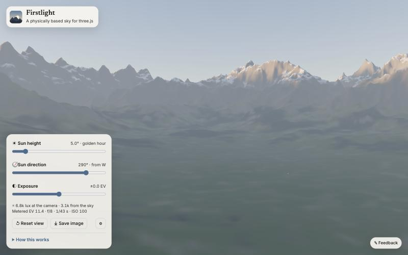
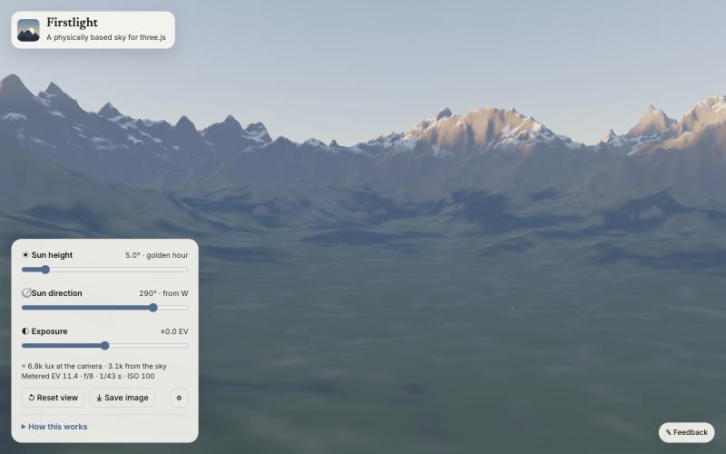
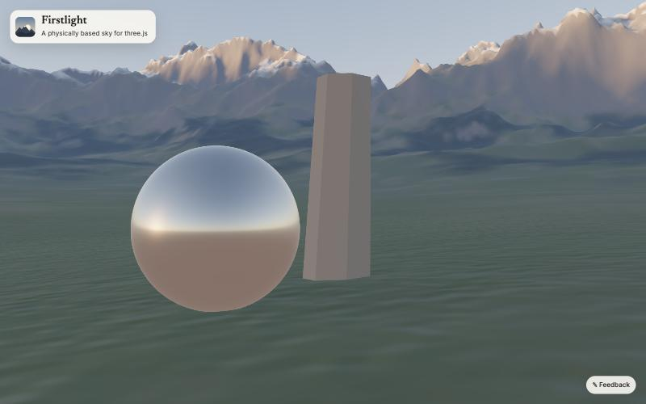
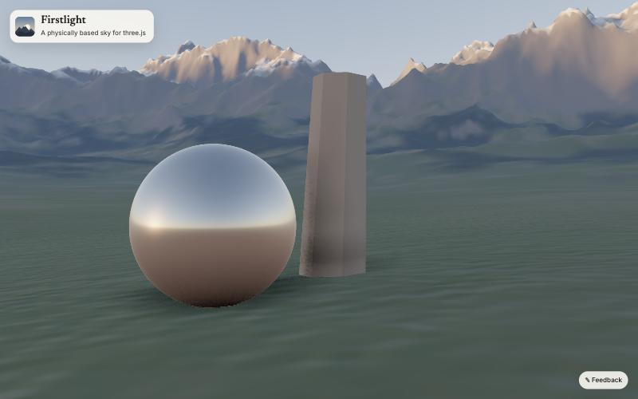
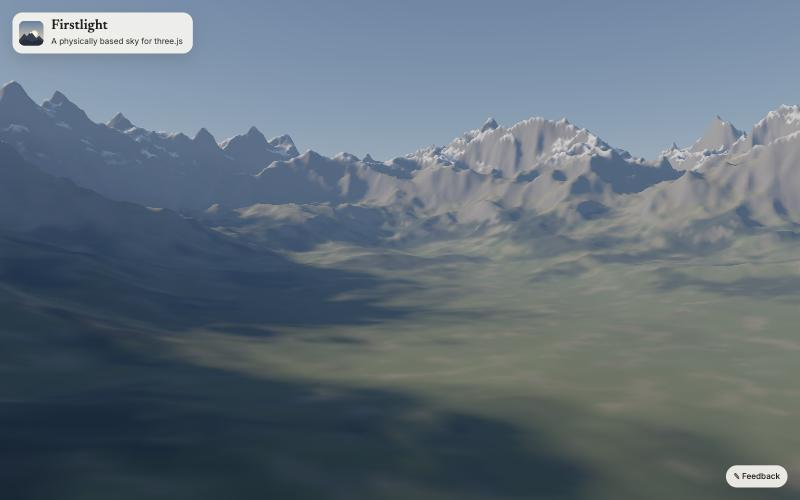
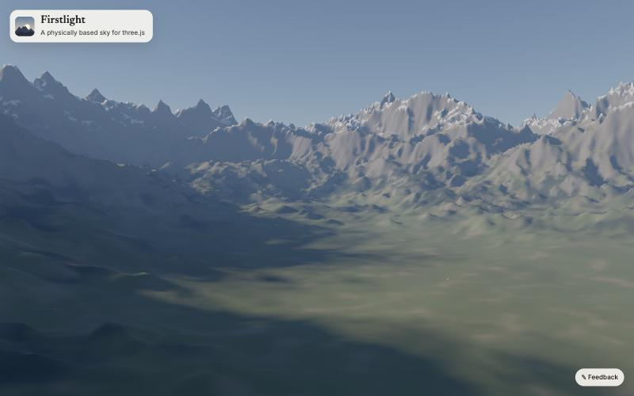
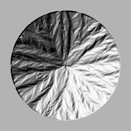

# Viz log

One entry per graphic: what it shows, why it needs this fidelity, the library, the data,
how it was checked, and what changed.

## Alpine valley demo (index.html), 2026-11-19

- **Shows:** a 20 km procedural valley under Earth's atmosphere, with a mirror-steel sphere
  (sky reflection) and a rough stone pillar (sun, sky light and shadow). The sun's height and
  direction are controls.
- **Why 3D at this fidelity:** the point is light through air over distance: haze that
  grows with range, sun colour that changes with the path length, mountain shadows. A flat
  picture can't show those changing together.
- **Library:** three.js r187 (WebGL2) plus Firstlight's own Hillaire 2020 implementation.
  Chosen over takram's three-atmosphere (Bruneton) so every line is ours to verify and
  extend; see SYSTEM-DESIGN.md.
- **Data:** Earth atmosphere constants from Hillaire 2020 and its code; Rayleigh
  coefficients at 680/550/440 nm (Bruneton). Terrain is procedural (seed 7). Albedos are
  labeled estimates within published ranges. Exposure (6) was chosen by eye.
- **Checked:**
  - **GPU vs CPU:** the transmittance LUT matches the CPU reference to 0.14% (self-check page).
  - **Published values:** Rayleigh optical depth against Bucholtz 1995 (+9% to +13%, documented).
  - **Sunset:** red/blue ratio 54 at 2°.
  - **Speed:** about 13.7 ms net GPU frame while orbiting at 1920×1200. Measured with GPU sync in the app's hidden browser pane, so it is an upper bound; recheck with Settings → Measure in a visible window.
  - **Looks:** screenshots in light and dark mode and at phone width.
- **Changes, in order:**
  1. **Wash-out.** The first render looked washed out. Exposure went from 10 to 6, tone-curve candidates (AgX, PBR Neutral, ACES) were compared side by side, and AgX was kept.
  2. **Flat floor.** The valley floor was a flat khaki. Per-pixel albedo and bump detail were added, fading with distance.
  3. **Dune-like peaks.** The mountains read as sand dunes. Rock was made darker, a conifer belt and a higher snow line were added, and the ridges sharpened.
  4. **Front lighting.** The sun sat behind the camera and lit everything flat. The default moved to side light (290°, 22°).
  5. **Composite cost.** Per-pixel aerial ray-marching took about 8.5 ms. It was replaced with Hillaire's 32³ froxel volume (about 2 ms), and the images matched by eye.
  6. **Shadow edge.** At golden hour, the shadow-map box left a hard edge on the floor. Terrain shadowing became a heightfield march, then a sun-visibility texture baked once per sun move. Every lit material samples that texture, so objects fall into mountain shadow with the ground.
  7. **Shadow map.** The sun's shadow map is cached while orbiting, since it only depends on the sun and the target.

## Alpine valley demo: real light units (2026-11-19)

- **Changed:** light in lux and cd/m², with a physical camera: an Auto incident meter, or Sunny 16 fixed. The slider is now exposure compensation in stops. A readout shows lux at the camera and the camera settings.
- **Checked:** self-check rows for photometry at a 60° sun: direct 99.5 klx, sky 9.1 klx, EV 15.41; EV falls from 15.41 to 13.88 to 11.38 as the sun drops from 60° to 20° to 5°. Seven unit tests cover the formulas.
- **Speed:** orbit ≈14.6 ms net; sun drag ≈17.0 ms net, after making the meter's GPU readback asynchronous (it was ≈20.9 ms synchronous).
- **Found:** a shaded valley looks hazy at low sun because aerial perspective ignores terrain shadows. Logged as a proposal.

## Alpine valley demo: shadowed haze (2026-11-19)

| Before (unshadowed haze) | After (terrain-shadowed haze) |
|---|---|
|  |  |

- **What:** single scattering in the aerial volume now respects terrain shadows.
- **Checked:**
  - **A/B pixels at a 5° sun:** a shaded ridge drops from 111/124/128 to 85/105/118.
  - **Near valley floor:** unchanged. There was little air in front of it, so its flat look is real sky-only light; ambient occlusion (roadmap #3) is what would address it.
  - **Noon:** identical with the effect on or off.
  - **Cost:** +0.8 ms.
- **Also found:** the asynchronous meter made the self-check read a stale sky value (6.7 klx instead of 9.1). Added `stage.settle()`, and the self-check uses it.

## Alpine valley demo: ambient occlusion (2026-11-19)

| AO off | AO on (indirect light only) |
|---|---|
|  |  |

- **What:** GTAO dims skylight and sky reflections where geometry hides the sky. The sphere's underside and the pillar's foot now sit on the ground instead of floating. Sunlight is untouched.
- **Tuning, by looking at the AO buffer:**
  - A 3 m radius was nearly invisible (mean AO 0.98). 40 m lost the near contact.
  - 10 m works for objects.
  - Distant terrain gets little at any radius: screen-space search is capped in pixels.
- **Cost, measured with GPU timer queries** (wall-clock timing in the hidden pane drifted to ±50 ms and was useless):
  - 0.5 resolution: +2.4 to 3 ms.
  - 0.35 resolution with 8 samples: cheap but grainy.
  - 0.35 with 12 GTAO and 16 denoise samples: +0.6 ms at the default view (15.3 → 15.9 ms GPU, 1920×1200).

## Alpine valley demo: terrain sky occlusion (2026-11-19)

- **What:** a baked sky-view factor dims skylight where ridges and gully walls hide the sky.
- **Checked:**
  - **Unit tests:** cos²h for a pit, ½ for a wall, (1 + cos S)/2 for a tilted plane, and 1 for any open slope.
  - **GPU vs CPU:** the bake matches the CPU reference to 0.002 at 64 vertices on the same height grid. Against the continuous noise it differs by 0.042, which is the grid's limit, not a bug.
- **Visible effect:** −1% mean brightness in both views, at most −4 to −5%. That's small because this valley is wide open. Forcing occlusion to zero drops mean brightness from 116.5 to 81.6, which proves the wiring.
- **Cost:** bake 8.2 ms once; per frame, zero within noise.
- **Bug found:** a render target made with `.clone()` shares its texture source with the original, so the two bakes overwrote each other. Fixed with a separate target.

## Alpine valley demo: erosion filter (2026-11-19)

| Erosion off | Erosion on (900 m, 40 m, 3 octaves) |
|---|---|
|  |  |

- **What:** branching gullies carved along the slope.
- **Checked:**
  - **Tests:** deterministic; flat ground untouched; on a cone, carving varies 3.3× more across the slope than along it (gullies run downhill); mean |Laplacian| on the flank rises 10×.
- **How it got here:**
  - The first attempt (700 m, 55 m, 2×2 cells) made egg-carton mounds and a bumpy floor. A top-down debug render showed broken stripes.
  - Fixes: back to 3×3 cells, a minimum slope below which nothing is carved, and wider, shallower gullies.
  - Build time went 2.1 s → 4.7 s, then down to 2.7 s after removing per-call allocations, `exp`, `PlaneGeometry` and its normal pass.
  - It then moved to a Web Worker: the longest main-thread task went from ~4 s to 0.47 s.
- **Also fixed:** below the horizon, the sky background showed a navy void before terrain loaded. It now shows lit ground seen through the air.

## Hello example (examples/hello.html), 2026-11-19

The same stage in 15 lines: terrain plus a steel sphere. It exists to prove the "30 lines"
done criterion and as a copy-paste starting point.

## Self-check (examples/selfcheck.html), 2026-11-19

A table, not a picture: the GPU-dependent done criteria with numbers and thresholds.
